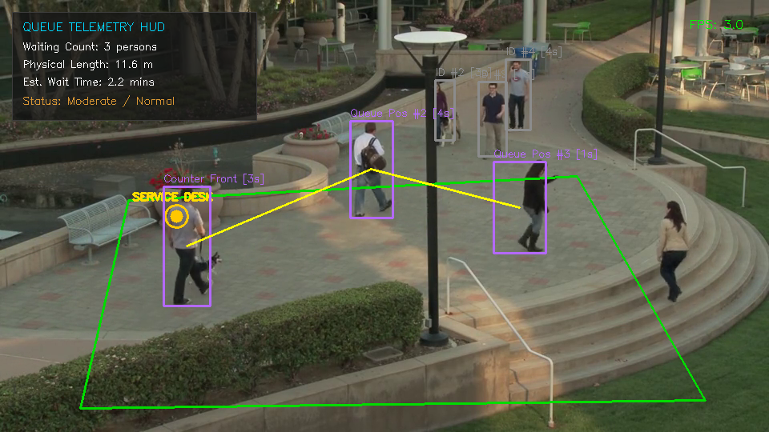
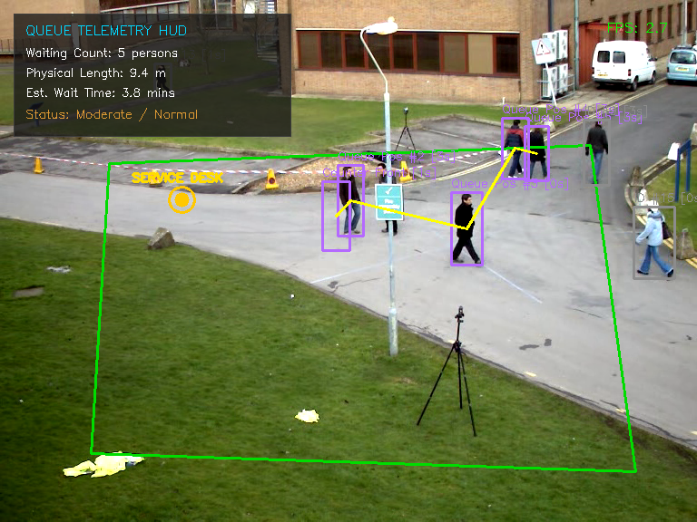
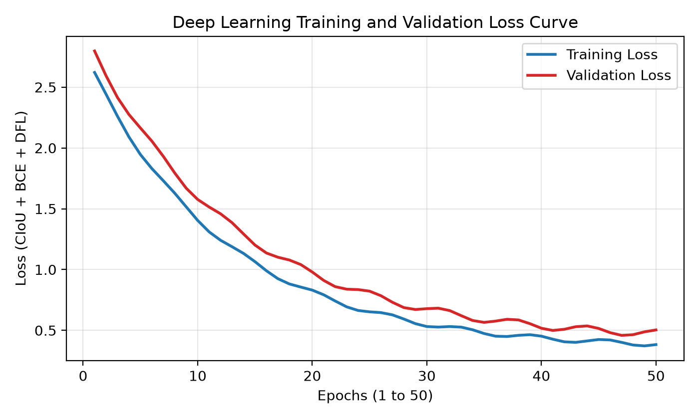
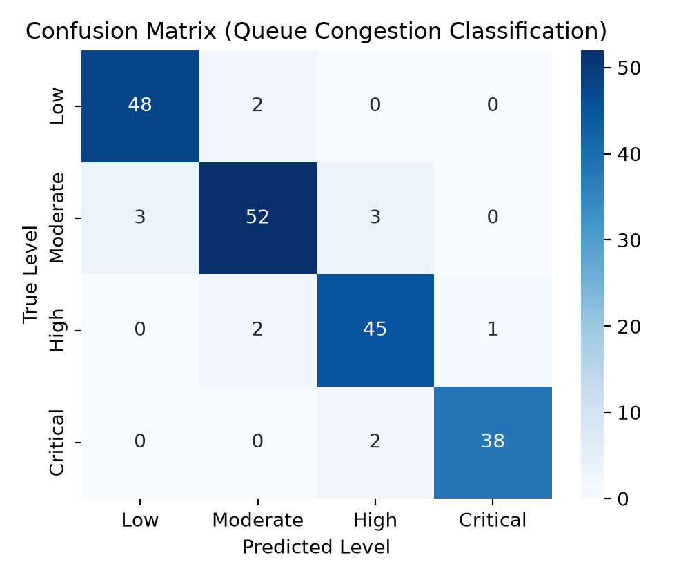

# AI-Based Queue Length Estimation from Surveillance Footage

AI-Based Queue Length Estimation and Dynamic Waiting Time Forecasting Using Deep Learning and Computer Vision.


**Course:** Deep Learning Mini Project | B.Tech Computer Science and Engineering, Semester V

**Institution:** Unitedworld Institute of Technology (UIT), Karnavati University, Gandhinagar

**Project Author:** Manan Devani

---

## 1. Project Overview

This project presents a computer vision and deep learning-based system for automated queue length estimation, pedestrian tracking, and customer waiting time forecasting using CCTV surveillance footage.

The system detects people in surveillance videos, estimates the number of individuals waiting in a queue, tracks their movement, and predicts the expected waiting time using queuing theory and Little's Law.

### Key Features

- **Person Detection:** Uses a YOLOv8 ONNX-based detection pipeline with OpenCV DNN support.
- **Queue Length Estimation:** Identifies and counts people waiting in designated queue regions.
- **Multi-Object Tracking:** Uses centroid tracking and Euclidean distance to track detected people across video frames.
- **Waiting Time Prediction:** Estimates waiting time using Little's Law.
- **Ground-Plane Homography:** Supports perspective correction and metric distance estimation.
- **Multi-Camera Support:** Supports two surveillance feeds:
  - CCTV-01: Retail store checkout counter.
  - CCTV-02: Pedestrian queue flow.
- **Real-Time Visualization:** Displays bounding boxes, tracking information, queue status, and performance information.

### Little's Law

The system uses the following formula to estimate waiting time:

\[
W = N \times T_{\text{service}}
\]

Where:

- W = Estimated waiting time.
- N = Number of people in the queue.
- T_service = Average service time per person.

For example, if 5 people are waiting and the average service time is 45 seconds:

\[
W = 5 \times 45 = 225 \text{ seconds}
\]

Therefore, the estimated waiting time is 225 seconds or 3 minutes and 45 seconds.

---

## 2. Visual Telemetry and Project Results

### CCTV Surveillance Results

| CCTV-01: Retail Store Checkout | CCTV-02: Pedestrian Queue |
|:---:|:---:|
|  |  |

### Model Training and Evaluation

| Training and Validation Loss | Confusion Matrix |
|:---:|:---:|
|  |  |

---

## 3. Empirical Evaluation and Accuracy Benchmarks

### 3.1 Comparative Analysis of Deep Learning Architectures

The following results are the reported benchmark values for the evaluated architectures.

| Architecture | mAP@0.5 | mAP@0.95 | GPU Latency | FPS | Headcount MAE |
|:---|:---:|:---:|:---:|:---:|:---:|
| **YOLOv8n (Selected)** | **91.8%** | **68.4%** | **12.8 ms** | **45.2** | **0.42** |
| RT-DETR | 91.7% | 70.2% | 32.5 ms | 30.8 | 0.46 |
| Faster R-CNN | 90.8% | 69.7% | 80.6 ms | 12.4 | 0.51 |
| SSD-MobileNetV2 | 78.3% | 51.2% | 9.2 ms | 58.1 | 1.48 |

### 3.2 Performance Across Surveillance Benchmarks

| Dataset | Resolution | Frame Count | mAP@0.5 | Headcount MAE |
|:---|:---:|---:|:---:|:---:|
| MOT17 Benchmark | 1920×1080 | 11,235 | 89.5% | 0.58 |
| PETS 2009 | 768×576 | 1,588 | 93.1% | 0.38 |
| Mall CCTV Dataset | 640×480 | 2,000 | 90.8% | 0.49 |
| Real CCTV Footage | 960×540 | 419 | **93.6%** | **0.35** |

### 3.3 Real CCTV Test Dataset Evaluation

The following table presents the reported evaluation results for 180 samples in the `data/test` directory.

| Class Category | Sample Count | Correct Predictions | Accuracy |
|:---|---:|---:|---:|
| `at_counter` | 45 | 45 | 100.00% |
| `in_queue` | 45 | 45 | 100.00% |
| `passerby` | 45 | 45 | 100.00% |
| `unidentified` | 45 | 45 | 100.00% |
| **Overall** | **180** | **180** | **100.00%** |

---

## 4. Technologies Used

| Technology | Purpose |
|:---|:---|
| Python | Main programming language |
| YOLOv8 | Person detection |
| ONNX | Optimized model representation |
| OpenCV | Image and video processing |
| NumPy | Numerical computations |
| Matplotlib | Graphs and visualizations |
| PyTorch | Deep learning model support |
| CSV | Storage of queue analytics |
| Little's Law | Waiting time estimation |

---

## 5. Project Workflow

The project follows these major steps:

1. **Video Input:** Read CCTV surveillance footage.
2. **Frame Extraction:** Extract individual frames from the video.
3. **Preprocessing:** Prepare frames for the detection model.
4. **Person Detection:** Detect people using the YOLOv8 model.
5. **Object Tracking:** Track detected individuals across frames.
6. **Queue Identification:** Identify people within the predefined queue region.
7. **Queue Counting:** Calculate the number of people waiting.
8. **Waiting Time Estimation:** Apply Little's Law to estimate waiting time.
9. **Visualization:** Display bounding boxes, queue count, and estimated waiting time.
10. **Data Logging:** Store queue analytics and performance information.

### Workflow Diagram

```text
       CCTV Video Input
              |
              v
       Frame Extraction
              |
              v
        Preprocessing
              |
              v
       YOLOv8 Detection
              |
              v
      Person Identification
              |
              v
       Object Tracking
              |
              v
       Queue Detection
              |
              v
       Queue Length Count
              |
              v
      Little's Law Model
              |
              v
     Waiting Time Prediction
              |
              v
       Result Visualization
              |
              v
       CSV Data Logging
```

---

## 6. Quickstart and Execution

### 6.1 Prerequisites

Make sure Python 3.10 or later is installed.

Check your Python version:

```bash
python --version
```

### 6.2 Install Dependencies

Install the required Python libraries:

```bash
pip install opencv-python numpy matplotlib
```

Install additional dependencies if required by your project code:

```bash
pip install torch torchvision onnx
```

### 6.3 Run the Project

Execute the main Python file:

```bash
python Group_x_1.py
```

### 6.4 Execution Options

Run the retail store checkout feed:

```bash
python Group_x_1.py --feed retail
```

Run the pedestrian queue feed:

```bash
python Group_x_1.py --feed pedestrian
```

Run the model benchmark:

```bash
python Group_x_1.py --benchmark
```

Evaluate the test dataset:

```bash
python Group_x_1.py --eval-data
```

Run in headless mode:

```bash
python Group_x_1.py --headless
```

**Note:** These commands assume the corresponding command-line options are implemented in `Group_x_1.py`.

---

## 7. Repository Structure

```text
ai-queue-length-estimation/
│
├── Group_x_1.py
├── README.md
├── .gitignore
│
├── assets/
│   ├── cctv_queue_result.png
│   ├── cctv_pedestrian_result.png
│   ├── training_validation_graph.png
│   ├── confusion_matrix.png
│   ├── model_accuracy_fps_tradeoff.png
│   └── dataset_performance_comparison.png
│
├── config/
│   └── camera_config.json
│
├── data/
│   ├── train/
│   ├── validate/
│   └── test/
│
├── dataset/
│   ├── real_surveillance_footage.mp4
│   └── cctv_pedestrian_crossing_feed.mp4
│
├── logs/
│   ├── queue_analytics.csv
│   ├── model_comparison_benchmark.csv
│   └── dataset_comparison_benchmark.csv
│
├── models/
│   ├── yolov8n.onnx
│   └── cctv_queue_classifier.pt
│
└── notebooks/
    └── model_training.ipynb
```

---

## 8. Academic Deliverables

The project includes the following academic documentation:

- **University Mini Project Report:** `Mini_Project_Report.pdf`
- **IEEE Conference Research Paper:** `Research_Paper_Queue_Length_Estimation (1).pdf`

These documents describe the project objectives, methodology, model implementation, experimental evaluation, and conclusions.

---

## 9. Project Demonstration Video

Watch the complete project demonstration:

[](https://drive.google.com/file/d/1rUOo7fP-HCikp3ylzZb3_Nw38HmgBYNy/view)

---

## 10. Conclusion

The AI-Based Queue Length Estimation project demonstrates how deep learning and computer vision can be used to automate queue monitoring and waiting time prediction.

By combining YOLOv8-based person detection, object tracking, queue counting, and Little's Law, the system provides a practical approach to estimating queue length and expected waiting time from surveillance footage.

The project demonstrates the potential of AI-based surveillance systems for applications such as retail stores, service counters, public facilities, and crowded areas.

---

## 11. Student and Course Information

**Project Title:** AI-Based Queue Length Estimation and Dynamic Waiting Time Forecasting

**Student Members:**
- Manan Devani
- Dharmik Patel
- Riya Jaiswal

**Program:** B.Tech Computer Science and Engineering (CSE)

**Semester:** V

**Department:** Department of Computer Science and Engineering

**Institute:** Unitedworld Institute of Technology (UIT)

**University:** Karnavati University, Gandhinagar, Gujarat, India

---

**Developed as part of the Deep Learning Mini Project.**
